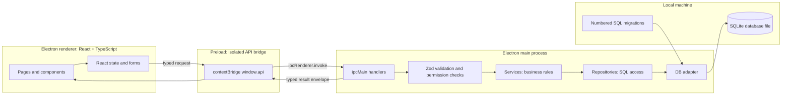
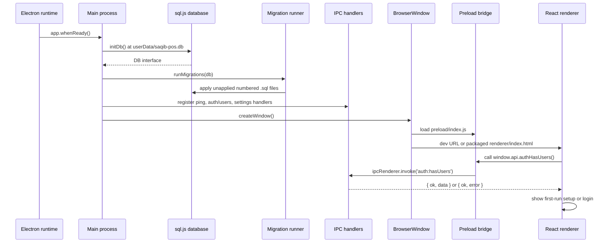
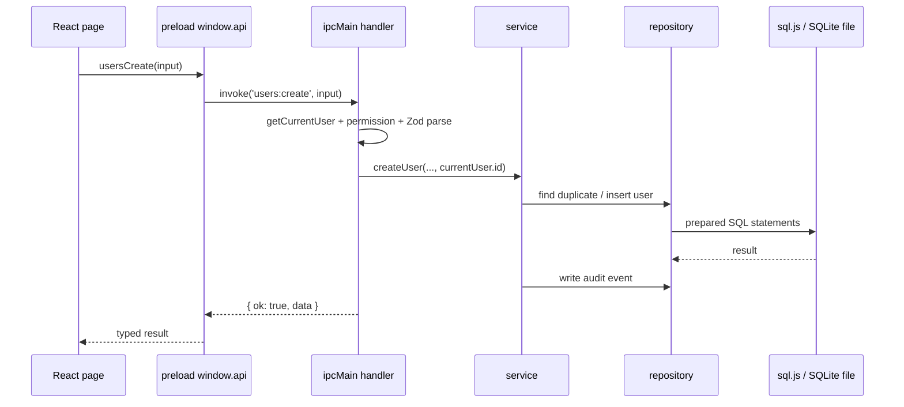
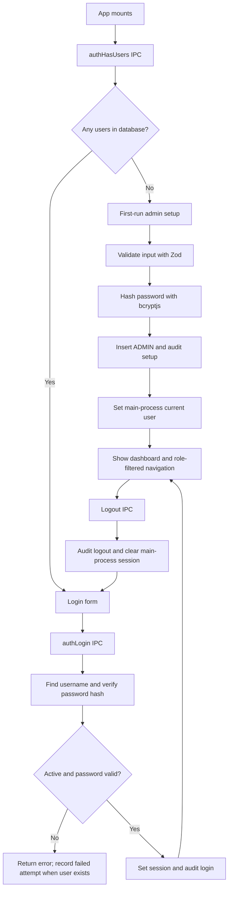
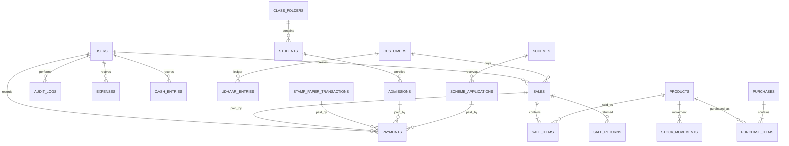
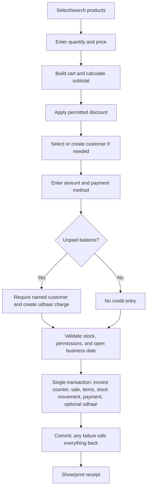

# Saqib POS Architecture and Workflows

This document describes both the architecture that exists in this repository and the larger POS workflows in `SPEC.md`. Features marked **Planned** are represented in the specification/schema but are not yet connected to renderer screens and IPC handlers.

## At A Glance



The renderer has no direct database, filesystem, or Node.js access. IPC is the process boundary. The app is designed for one Windows computer and offline use; there is no remote API or synchronization service in the current implementation.

## Technology Stack

| Area | Technology in this repository | Purpose |
|---|---|---|
| Desktop runtime | Electron 31 | Main process, native window, IPC, packaging target |
| Build and development | electron-vite 2, Vite 5 | Bundles main, preload, and renderer; dev server for renderer |
| UI | React 18, React DOM 18 | Desktop renderer and page components |
| Language | TypeScript 5 | Main, preload, renderer, and shared contracts |
| Styling | Tailwind CSS 3, PostCSS, Autoprefixer | Renderer styling |
| Runtime database | SQLite using `sql.js` 1 (WASM) | In-memory SQLite engine persisted to a local `.db` file |
| Test database dependency | `better-sqlite3` 13 | Native SQLite dependency in the project; the Electron runtime connection currently uses `sql.js` |
| Validation | Zod 3 | IPC input schemas and shared data contracts |
| Password hashing | bcryptjs 3 | Hashes passwords with 10 rounds in `AuthService` |
| Tests | Vitest 1 | Unit/integration test runner |
| Windows distribution | electron-builder 24 | Installer configuration in `package.json` |

Useful commands: `npm run dev`, `npm run build`, `npm run typecheck`, `npm run lint`, and `npm test`.

## Repository Layout

```text
src/
  main/
    index.ts                 Startup, migrations, handler registration, shutdown
    window.ts                BrowserWindow security settings and renderer loading
    db/
      connection.ts          Main-process DB singleton and user-data path
      db.ts                  Small synchronous DB interface
      migrate.ts             Numbered SQL migration runner
      sql-js-adapter.ts      sql.js adapter and persistence implementation
    ipc/                     IPC endpoints, validation, authorization, result envelopes
    services/                Auth, settings, and in-memory session business logic
    repositories/            SQL queries for users, settings, and audit records
  preload/
    index.ts                 Typed, allow-listed `window.api` bridge
  renderer/
    src/app/App.tsx          Setup/login state and authenticated page routing
    src/components/          Shared layout and UI components
    src/pages/               Feature pages and placeholders
    assets/index.css         Tailwind directives and global styles
  shared/
    constants/               Roles, enums, permission helpers
    schemas/                 Zod schemas and inferred TypeScript types
    types/api.ts             Typed IPC API and result envelope
migrations/
  001_init.sql               Initial schema, indexes, views, and default settings
tests/                       Vitest tests
```

## Process And Startup Flow



On Windows and Linux, closing all windows closes the database and quits Electron. The database is stored under Electron's `app.getPath('userData')` directory, not beside the source files. Tests may use `:memory:` when initializing the DB layer.

## Request And Data Flow

1. A page collects input and calls a method on `window.api`.
2. The preload bridge forwards only the explicitly exposed method through `ipcRenderer.invoke`.
3. An `ipcMain` handler checks whether the user is authenticated, checks the role where required, and validates input with the corresponding Zod schema.
4. The handler invokes the relevant service and converts success/failure to the shared `IpcResult<T>` shape.
5. A service applies business rules, uses repositories for SQL, and records audit events where implemented.
6. The DB adapter executes SQL. Persistence to the local database file occurs after `exec`, after a successful transaction, and on close; a standalone prepared-statement `.run()` is not immediately flushed.
7. The result returns over IPC; the page updates its React state or displays the error.



Every exposed API returns `{ ok: true, data }` or `{ ok: false, error: { code, message } }`. The main-process session supplies the acting user; a renderer must not be trusted to assert its own identity or role.

## Startup, Setup, Login, And Session



The current session is an in-memory singleton in the main process. It is not restored after an application restart; the user signs in again. The current page routing lives in `src/renderer/src/app/App.tsx`.

## Database And Persistence

`migrations/001_init.sql` creates the initial schema, indexes, views, and default settings. `runMigrations()` finds migration files, sorts them by filename, skips IDs already present in `schema_migrations`, and applies the remaining SQL. Add a new numbered migration for schema changes; do not rewrite a migration already shipped to users.

The production Electron connection uses `sql.js`, a WASM SQLite engine. It loads the database file into memory, and `SqlJsDatabase` serializes and writes the database file after `exec`, successful transactions, and close. A standalone prepared-statement `.run()` changes the in-memory database but does not itself call `persist()`; current user/settings services issue such statements directly, so those writes are flushed on a later persistence trigger (normally app close). A crash before that trigger can lose those changes. This differs from a native SQLite connection with WAL-backed incremental writes. `PRAGMA foreign_keys = ON` is requested; WAL is best-effort and sql.js may not support it.



### Data Groups

| Group | Tables/views | Purpose |
|---|---|---|
| Identity and configuration | `users`, `settings`, `schema_migrations`, `counters` | Accounts/roles, key-value settings, migration history, per-day receipt sequence |
| Customers and inventory | `customers`, `categories`, `products`, `suppliers`, `purchases`, `purchase_items`, `stock_movements` | Customer records, catalog, purchases, stock ledger |
| Sales and returns | `sales`, `sale_items`, `sale_returns`, `sale_return_items`, `payments` | Sales, line items, refunds, and payment records |
| Credit ledger | `udhaar_entries`, `v_udhaar_balance` | Charges and repayments; balance is derived from ledger entries |
| Other business modules | `stamp_paper_transactions`, `stamp_transaction_payments`, `stamp_transaction_documents`, `stamp_paper_inventory`, `parties`, `stamp_paper_sales`, `class_folders`, `students`, `admissions`, `schemes`, `scheme_applications` | Simplified stamp transactions and attachments; retained serial/party workflow tables; admissions and schemes |
| Cash and operations | `expenses`, `cash_entries`, `daily_closings`, `audit_logs`, `backup_logs` | Cash in/out, closeout, audit history, and backup history |
| Derived inventory view | `v_low_stock` | Active products at/below their low-stock threshold |

Data conventions from the product spec: money is integer PKR rupees (never floating point); dates are local ISO text; passwords are hashes, not plaintext. Schema constraints enforce role/status values and ensure each payment is linked to exactly one supported business record.

## Main-Process Layers

| Layer | Responsibility | Current code examples |
|---|---|---|
| IPC handlers | Parse inputs, check authentication/permissions, call services, return result envelopes | `src/main/ipc/auth.handler.ts`, `settings.handler.ts`, `ping.handler.ts` |
| Services | Business logic, session changes, password hashing, audit events | `AuthService`, `SettingsService`, `session.ts` |
| Repositories | SQL queries and writes only | `UserRepository`, `SettingsRepository`, `AuditLogRepository` |
| DB interface/adapter | Common synchronous SQL interface, transactions, persistence | `db.ts`, `sql-js-adapter.ts` |
| Shared contracts | Zod schemas, inferred input/output types, `WindowApi`, roles/permissions | `src/shared/schemas`, `types`, `constants` |

Handlers should remain thin. Keep validation and authorization at the IPC boundary, put business rules in services, and keep repositories free of policy decisions. Do not pass an untrusted user ID or role from the renderer as authority; derive it from `getCurrentUser()` in main.

## Security Boundary

- `BrowserWindow` has `contextIsolation: true` and `nodeIntegration: false`; sandbox is currently disabled because the preload needs Electron APIs.
- The preload exposes a typed allow-list rather than raw `ipcRenderer`.
- IPC inputs are validated with Zod schemas before being used.
- User/role permissions are checked in main-process handlers.
- Passwords use bcryptjs hashing; audit logs capture account and settings actions.
- Keep remote content and arbitrary Node access out of the renderer.

Security note: the current `window.ts` does not enable `sandbox: true`; do not describe the app as sandboxed unless that setting is changed and verified.

## Current Feature Coverage

| Feature | Renderer status | Main/API status |
|---|---|---|
| First-run admin setup and login | Implemented | Auth handlers, bcrypt hashing, session and audit events implemented |
| User management | Implemented | List/create/change role/deactivate/reset password APIs and permission checks implemented |
| Stamp Paper | Simplified transaction form and history | Reference name, customer, registration, status, paisa payment records, multiple encrypted attachments, and history use the existing stamp transaction table plus additive migration 004. Earlier serial inventory/party tables and APIs remain for data compatibility but are no longer shown in the Stamp Paper screen. |
| Settings | Placeholder UI currently | Get/update handlers, service, repository, and admin update permission implemented |
| Dashboard | Placeholder UI | No dashboard data API currently registered |
| Sales, admissions, schemes, udhaar, inventory, reports, daily closing, backup | Placeholder UI | Schema/spec exists in part; corresponding feature IPC/services are not currently registered |

The product specification describes the intended complete POS. The following workflows are therefore design requirements, not claims about current working features.

## Target Business Workflows (From SPEC.md)

### Sale And Payment



The sale is intended to be atomic: validate available stock, create sale and items, reduce stock, record payment and any credit charge, and allocate the invoice number in one transaction. A saved sale is not edited in place; corrections use a return workflow.

### Other Target Workflows

| Workflow | Intended path |
|---|---|
| Stamp paper | Enter reference name, customer name, registration, status, remarks, payment values, and multiple supporting attachments; save a stamp transaction and collect later payments |
| Admission | Choose class/year folder; find or add student; save admission; collect fee/payment; issue receipt; export data |
| Scheme application | Choose scheme; enter applicant/CNIC/mobile/category; save application and status; collect fee/payment; issue receipt; export data |
| Udhaar | Open customer ledger; record charge or repayment; compute outstanding balance from entries; review history |
| Inventory | Maintain catalog/categories; record purchases and adjustments; write stock movements; view low-stock/profit reports |
| Daily closing | Enter opening cash; aggregate cash payments, cash in/out, refunds, and cash expenses; compare expected/actual; lock date |
| Backup/restore | Create backup and history; verify restore candidate and preserve current database before replacing it |

## Target Business Invariants

- Save monetary business operations atomically; do not leave partial records on failure.
- Reject sales that would make stock negative unless an explicit future setting permits it.
- Udhaar requires a named customer; derive balance as charges minus repayments.
- A locked day rejects new or modified money entries dated on that day; only Admin may unlock it, with an audit record.
- Generate receipt numbers from `counters` inside the same transaction as the record being saved.
- Enforce role permissions in main process, not only by hiding renderer navigation.
- Use audit logs for privileged or consequential changes.

## Transactions, Tests, And Packaging

The DB interface provides a synchronous transaction wrapper. Do not `await` inside a SQLite transaction. The target sale/return/closing flows should use one transaction per logical operation and have tests proving rollback and invariants.

Vitest is configured for tests. The existing migration tests wrap `better-sqlite3` in the shared DB interface and exercise the real numbered migration, including idempotence; the Electron DB connection uses `sql.js`. Keep tests exercising real numbered migrations so the schema used in tests tracks the shipped schema.

`electron-vite build` produces separate main, preload, and renderer bundles. `electron-builder` is configured for a Windows NSIS installer. Verify database persistence and migrations on a clean Windows install before distribution.
