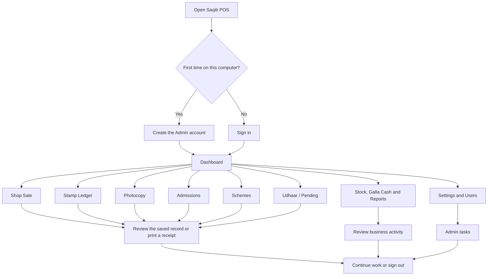
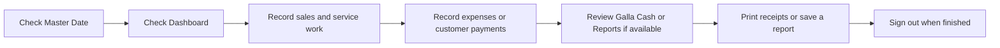

# Saqib POS — User Manual

**A simple guide for shop staff and managers**  
Current app version: **0.1.0**

This guide explains the screens in everyday language. You do not need computer or accounting experience to use it.

## 1. What the app is for

Saqib POS helps you record shop sales, payments, customer balances, photocopy work, stamp transactions, admissions, schemes, stock, expenses, and reports. The app is designed to work offline. Use it on the computer where your shop's POS data is kept.

The app saves records as you use the **Save**, **Record**, or similar buttons. Check the confirmation message before starting another transaction.

## 2. First time and signing in

### First time setup

When the app has no user accounts, it asks you to create the first **Admin** account:

1. Enter the Admin's name and a username.
2. Choose a password of at least 6 characters and enter it again to confirm.
3. Select **Create Admin Account**.
4. Keep the account details private. This first account can access the whole system.

### Normal sign in

1. Enter your username and password.
2. Select **Sign In**.
3. To leave the app, select **Out** at the bottom of the left menu.

There is no self-service password reset on the sign-in screen. Ask your Admin for help if you cannot sign in.

## 3. Screen map

The left menu opens the sections available to your account. The Dashboard is the starting screen after sign-in.

### Access by role

Some menu items are hidden unless your account has permission.

| Account | Typical access |
|---|---|
| **Admin** | All working sections, including Filer Customers, Galla Cash, Stock, Reports, Users, and Settings. |
| **Manager** | Shop and service sections, Galla Cash, Stock, and Reports. Users and Settings are Admin-only. |
| **Cashier** | Day-to-day sales and service sections. Stock management, Galla Cash, Reports, Filer Customers, Users, and Settings are not in the Cashier menu. Some actions inside a section may also be restricted. |

If a button is missing or the app says you do not have permission, ask an Admin or Manager rather than using someone else's account.

## 4. Dates and money

- **Master Date** appears at the top of the main screen. Changing it puts supported screens into that date's view. A red highlight means you selected a past date; select **Today** to return.
- Some sections have their **own date fields**. For example, Galla Cash and Reports each have a separate date range. Always check the date shown in the form or report before saving or printing.
- Enter amounts in **PKR**. Follow the form's instructions: most everyday sale and fee fields accept whole rupees, while some stamp transactions can accept paisa.
- A date range must start on or before its end date.

## 5. Daily work and the Dashboard

The Dashboard gives a quick view of activity for the selected date. Select **Refresh** if you want to reload the figures. Select a card marked **See detail** or click a detail-enabled card to open its breakdown.

Available Dashboard actions depend on your role:

- **New sale** opens Shop Sale.
- **Add expense** records a shop expense. Enter its category, amount, payment method, and expense date; add a note if useful.
- **View all expenses** shows saved expenses.
- **Day opening** is available to the Admin. Enter the cash physically present at the start of the day and an optional note. Opening cash is not automatically carried forward, so the Admin should check it for each day.

The Dashboard's **Current balance** excludes Filer receipts. Galla Cash's **Expected drawer cash** includes dated Filer cash receipts, so the two figures may differ.

### Suggested everyday workflow

## 6. Shop Sale

Use **Shop Sale** for product sales and customer credit.

### Record a sale

1. Open **New sale**.
2. Search for a product and select it. Add each item and adjust its quantity. Out-of-stock items cannot be selected.
3. Select a customer if the sale is on credit. For a walk-in customer, choose **Walk-in / no customer**. Pending work requires a customer name.
4. Enter any discount, the amount received, and the payment method.
5. Set **Work Status** to **Work Completed** or **Work Pending**.
6. Check the total and remaining balance, then select **Complete sale & print receipt**.
7. Review the saved sale and print the receipt if needed.

There is also a **Quick Photocopy Entry** for recording a simple photocopy charge from Shop Sale. Use the separate Photocopy section for print type, duplex, customer, date-filtered history, and refund details.

### Find a previous sale

Open **Sales History**, search by invoice or customer, and select **View / print**. The detail screen shows payment and return information. Return or protected deletion actions may require a Manager/Admin and a PIN or reason.

## 7. Stamp Ledger

Use this section to record stamp-related transactions and their payments.

1. Open **New Transaction**.
2. Enter the transaction details requested on screen, such as reference or department, customer/registration information, date, and status.
3. Enter the sale price, service charges, and any payment received. Choose the correct payment method.
4. Add optional remarks or attach a JPEG, PNG, or PDF document if needed.
5. Select **Save Transaction**.

Use **History** to search by invoice, ticket, reference, customer, or registration. You can apply date filters and select **Search**. Open a row to view its payment history, record a later payment when a balance remains, and print a receipt. Managers/Admins can use available edit, cancellation/refund, and attachment-management actions. **Export Excel** exports the visible transaction history.

## 8. Photocopy

Use this section for detailed photocopy jobs.

1. Choose **Black and white** or **Color**.
2. Enter the number of pages/sides, copies, and price per side/copy.
3. Select **Duplex printing** if the work is double-sided.
4. Optionally enter the customer and a reference or department.
5. Choose the payment method and select **Save and print later**.
6. To print later, find the job in **Job history** and select **Print**.

Use the **From** and **To** dates to view jobs in a period. A Manager/Admin can select a completed job, choose a refund method, enter a reason, and confirm a full refund.

## 9. Admissions & Fees

This section keeps student records, class folders, admission fees, and related documents.

### Set up a class folder first

1. Open **Classes & Sessions**.
2. Enter the class name, academic year/session, and standard admission fee.
3. Select **Create class**.

Class folders can be viewed by staff with Admissions access. Creating or managing them requires a Manager/Admin.

### Add a student

1. Open **Add Student**.
2. Enter the student's and guardian's details.
3. Choose the class folder and enter the admission and academic information.
4. Check the initial fee, discount, and due date.
5. Select **Save admission**.
6. Collect money separately from the student's fee ledger; saving an admission does not itself record a payment.

### Collect or review a fee

1. Open **Students & Fees** and search or filter for the student.
2. Open that student's fee-management view.
3. Enter the amount, payment method, and any reference or notes.
4. Record the payment and print or reprint its receipt if needed.

The Overview shows fee totals, students with outstanding fees, and roll-number slips due or overdue. Student documents and roll-slip information are managed from the student's details. Use **Export CSV**, **Export Excel**, or **Print report** when available.

## 10. Filer Customers

This section is available to the Admin.

1. Select **Add customer**.
2. Enter the customer's name, CNIC, filing date, category, total fee, and any advance already paid.
3. Attach a PDF, JPG, or PNG proof document if needed.
4. Select **Add customer**.
5. Use **Payments** on the customer row to record a dated payment. Choose its payment method and add an optional remark.
6. Use **Edit** to correct customer details, or the proof link to view the saved document.

**Important:** “Opening advance” is an amount already paid when the account is set up. It is not a new, dated cash receipt. Record new money received through **Payments** so its date and method are saved.

## 11. Schemes

Use this section to manage schemes, applications, application fees, and status updates.

- Use **Overview** for scheme/application totals and recent applications or payments.
- In **Schemes**, search or filter schemes. A Manager/Admin can add or edit schemes and change their lifecycle when those actions are available.
- Open **Applications** to search by application or applicant details and filter by scheme, status, date, or payment status.
- Open an application to review its details, update its status when permitted, manage its fee, and print a payment receipt.
- Enter the actual payment amount and method when collecting a fee. The application record and its fee payment are separate actions.
- Use **Export Excel** when available to export the applications shown by the section.

If a required document is missing, a status change may be blocked. Ask the applicant for the required document and try again.

## 12. Udhaar / Pending

Use this section for customer credit accounts and repayments.

1. Select **Add customer** and enter the customer's name and optional contact details.
2. Open the customer account.
3. Select **Add charge** to record an amount owed, or **Record repayment** when the customer pays.
4. For a repayment, enter the amount, date, payment method, and optional reference or note.
5. Review the account ledger and remaining balance. Print the repayment receipt when needed.

The **Outstanding by customer** view helps locate unpaid amounts, including amounts associated with a module or reference. Cash repayments are also included in the cash reconciliation; they are not counted twice as a second cash receipt.

## 13. Stock

Stock management is available to Managers and Admins.

### Add or update a product

1. In **Products**, select **Add product**.
2. Enter the name, purchase price, sale price, and low-stock alert level.
3. Select **Save product**.

Use product search to find an item. Use its available actions to edit or deactivate it.

### Record a purchase

1. Add a supplier first if you want to keep supplier details.
2. Open **Purchases** and enter the optional supplier, product, quantity, unit cost, purchase date, and note.
3. Select **Save purchase & update stock**.

### Correct a stock count

Use **Adjust stock**, choose the product, enter a positive number to add stock or a negative number to remove stock, and provide a reason and date. Check the quantity carefully before saving. Use **Movements** to review stock changes.

## 14. Galla Cash

Galla Cash is a read-only cash and business-activity overview. It is available to Managers and Admins.

1. Set the **From date** and **To date** for the report. These dates are separate from Master Date.
2. Review **Business activity** for billed amounts, receipts, refunds, and outstanding balances.
3. Review **Cash summary** for expected drawer cash.
4. Select a module card to see its detailed breakdown. Expand **How expected cash is calculated** to see the components.

Expected drawer cash is calculated from opening cash, section cash receipts, dated Filer receipts, saved cash movements, cash-paid expenses, and cash refunds. Udhaar cash repayments are included through cash movements.

The current Galla Cash page does not provide controls to enter manual cash-in/cash-out entries or to count and close the drawer. An Admin can unlock a locked day if the button is shown. Do not treat this screen as a place to record a physical cash count.

## 15. Reports

Reports are available to Managers and Admins.

1. Set **From** and **To** dates. The report refreshes when the range changes; select **Refresh** if needed.
2. Review the summary and select a section card to see its details.
3. Select **Print / PDF** to open the computer's print dialog. Choose a printer or a PDF option if available on the computer.
4. Select **Export Excel**, choose a file name and location in the save window, and save the workbook.

The report includes sales, service modules, stock, cash, and digital-account summaries as available to your role. Stock value is the current stock value, while purchase and movement activity is filtered by the selected period.

## 16. Users and Settings

### Users (Admin only)

1. Enter the staff member's name, username, temporary password, and role.
2. Select **Add user**.
3. Use the role list to change an active user's role.
4. Use **Deactivate** to prevent an account from being used. Deactivation is preferable to sharing or reusing an account.

Give each person their own account. Do not share passwords.

### Settings (Admin only)

Settings include the shop name printed on receipts, receipt paper width, the maximum Cashier discount, and security PINs. Change only values you have confirmed with the shop owner. Select **Save settings** to apply changes or **Discard changes** to undo unsaved edits.

Keep the login and delete PINs private. The delete PIN is used for protected sale deletion.

## 17. Backup and Restore

The **Backup & Restore** menu currently opens an informational placeholder, not a working backup tool. Do not assume that opening this page or using the app creates a backup. Ask your software support contact or shop owner to arrange a verified backup process before relying on this computer as the only copy of your records.

## 18. Receipts, printing, and common problems

- When a print window opens, check the selected printer, paper size, and preview before printing.
- If the receipt printer is not available, you can often choose a PDF printer in the system print window.
- If an item is out of stock, ask a Manager/Admin to check Stock before making the sale.
- If a save fails, read the message, correct the highlighted or missing information, and try again. Do not repeatedly submit the same payment if the app is still processing.
- If a date is wrong, correct the date before saving. For reports, check the displayed date range before printing or exporting.
- If a screen is blank or shows an error, select **Refresh** if available. If the problem continues, note the screen, date, and message, then contact your Admin or support contact.

## 19. Quick reference

| You need to… | Open… |
|---|---|
| Sell a product or record customer credit | **Shop Sale** |
| Record stamp work or a stamp payment | **Stamp Ledger** |
| Record or print a photocopy job | **Photocopy** |
| Add a student or collect an admission fee | **Admissions** |
| Record a filing client or payment | **Filer Customers** (Admin) |
| Register an applicant or collect a scheme fee | **Schemes** |
| Check or record a customer repayment | **Udhaar / Pending** |
| Add a product or receive a purchase | **Stock** (Manager/Admin) |
| Review cash for a date range | **Galla Cash** (Manager/Admin) |
| Print or export a date-range report | **Reports** (Manager/Admin) |
| Add staff or change shop settings | **Users** or **Settings** (Admin) |

